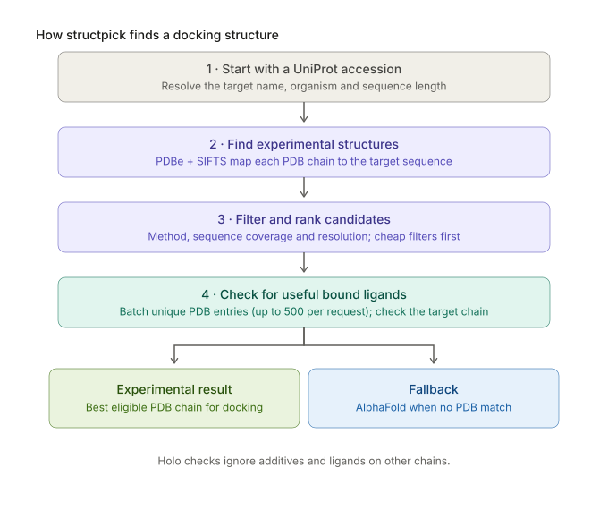

# structpick

[](https://github.com/felipsoliveira/structpick/actions/workflows/tests.yml)
[](https://pypi.org/project/structpick/)
[](https://pypi.org/project/structpick/)

Pick a protein structure to dock against.

Given a UniProt accession, `structpick` combines target metadata with experimental structures from PDB/PDBe, ranks them by sequence coverage and resolution, and checks which structures have a non-additive ligand bound on the target chain. If no experimental structure matches the filters, AlphaFold is available as a fallback. It turns the first step of structure-based drug design from manually checking many PDB pages into one reproducible command.

## Why I built it

In my biomolecular physics research, structure-based drug design starts with picking a protein structure that is useful for docking. For a target with many PDB entries, comparing sequence coverage, resolution, and bound ligands by hand gets repetitive. I built `structpick` to make that first pass repeatable from a UniProt accession.

It does not run docking or predict a binder. It narrows the structure search and shows the information behind the choice. I also wanted a public Python project connected to the kind of research I do.



```console
$ structpick list Q27743 --holo --max-resolution 2.0 --top 5
Q27743: L-lactate dehydrogenase | Plasmodium falciparum (isolate CDC / Honduras) | 316 aa
rank  pdb_id  chain  method             resolution  coverage  residues  ligands
1     4plz    A      X-ray diffraction  1.05        100%      1-316     NAI,OXM
2     1t2d    A      X-ray diffraction  1.10        100%      1-316     NAD,OXL
3     2a94    A      X-ray diffraction  1.50        100%      2-316     AP0
4     1t24    A      X-ray diffraction  1.70        100%      1-316     NAD,OXQ
5     1u4o    A      X-ray diffraction  1.70        100%      2-316     NDD
AlphaFold: AF-Q27743-F1 v6, mean pLDDT 97.4, 98% of residues very high confidence
```

Looking for a structure of EGFR with erlotinib (`AQ4`) bound:

```console
$ structpick list P00533 --method xray --ligand AQ4 --top 3
P00533 (EGFR): Epidermal growth factor receptor | Homo sapiens | 1210 aa
rank  pdb_id  chain  method             resolution  coverage  residues  ligands
1     1m17    A      X-ray diffraction  2.60        28%       695-1022  AQ4
2     4hjo    A      X-ray diffraction  2.75        28%       696-1022  AQ4
AlphaFold: AF-P00533-F1 v6, mean pLDDT 75.9, 47% of residues very high confidence
```

## Install

```bash
pip install structpick
```

Python 3.10 or newer. The only dependency is [httpx](https://www.python-httpx.org/).

## Usage

```bash
structpick list <accession> [filters] [--top N] [--format table|csv|json]
structpick fetch <accession> [filters] [-o DIR] [--alphafold]
```

| Option | Meaning |
|---|---|
| `--max-resolution 2.0` | drop entries worse than 2.0 Å (also drops NMR, which has no resolution) |
| `--min-coverage 0.8` | keep chains covering at least 80% of the UniProt sequence |
| `--method xray` | `xray`, `em`, `nmr` or the full PDBe method name |
| `--ligand HEM` | only chains with this ligand bound |
| `--holo` | only chains with any ligand that isn't an additive or ion |

`fetch` downloads the best match as mmCIF from RCSB. If nothing matches the filters, or with `--alphafold`, it downloads the AlphaFold model instead.

`--format csv` and `--format json` are meant for scripts and notebooks:

```bash
structpick list P00533 --holo --format csv > egfr_structures.csv
```

### From Python

```python
from structpick import Filters, select_structures
from structpick.api import Client

with Client() as client:
    structures = client.with_ligands(client.structures("P00533"))
    best = select_structures(structures, Filters(max_resolution=2.5, require_ligand=True))
    for s in best[:3]:
        print(s.pdb_id, s.chain, s.resolution, [lig.code for lig in s.bound_ligands])
```

## How ranking works

1. **Coverage**, compared in 10% steps, so a chain covering 99% and one covering 100% count as equal.
2. **Resolution**, best first. Entries without a resolution (NMR) go last.

Ligands only count if they sit on the same chain and aren't in the [additive list](src/structpick/models.py) (water, glycerol, ethylene glycol, PEG, sulfate, phosphate, common buffers, ions, detergents). Metal ions are on that list too, so check catalytic metals yourself when they matter.

## Data sources

- [UniProt REST API](https://rest.uniprot.org) for the target name, gene and length
- [PDBe best structures](https://www.ebi.ac.uk/pdbe/api/doc/sifts.html) (SIFTS mappings) for chain coverage, method and resolution
- [PDBe ligand monomers](https://www.ebi.ac.uk/pdbe/api/doc/pdb.html) for bound ligands
- [AlphaFold Protein Structure Database](https://alphafold.ebi.ac.uk/api-docs) for predicted models

Requests time out after 30 s and are retried with exponential backoff on 429 and 5xx responses. Ligand metadata is fetched only after the other filters, for unique PDB entries in batches of up to 500 IDs per request; this replaces one serial ligand-lookup request per entry.

## Development

```bash
git clone https://github.com/felipsoliveira/structpick
cd structpick
uv sync                   # or: pip install -e . pytest pytest-cov ruff mypy
uv run pytest             # offline, uses recorded API responses in tests/fixtures
uv run pytest -m network  # hits the real APIs
uv run ruff check . && uv run mypy
```

## License

MIT
